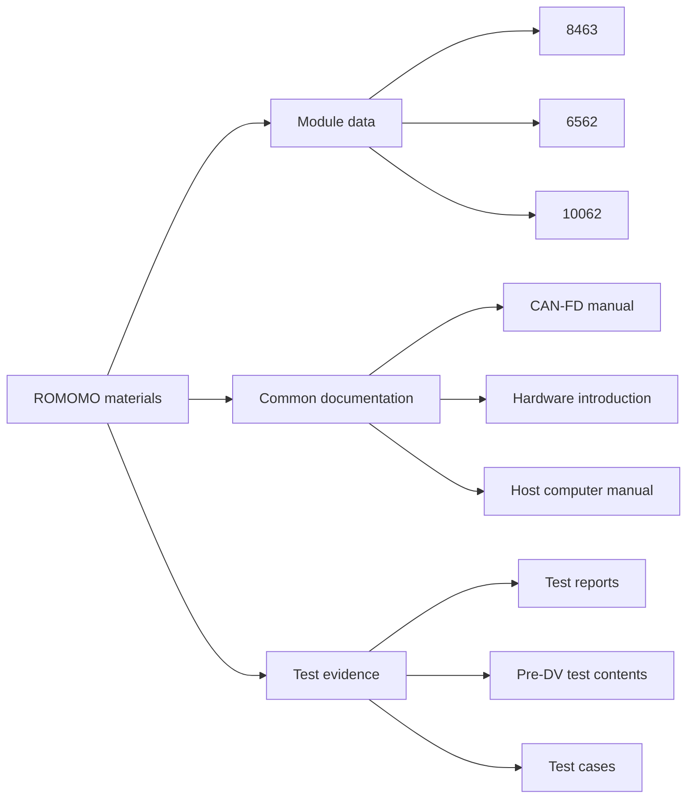

# ROMOMO Open Materials

[](LICENSE) [](https://github.com/Roboparty/ROMOMO) [](https://github.com/Roboparty/ROMOMO)

Public documentation, specifications, and test reports for RoboParty / ROMOMO joint modules.

[中文说明](README.zh-CN.md) · [Browse the files](https://github.com/Roboparty/ROMOMO/tree/master)

## At A Glance

| Module | Rated voltage | Reduction ratio | Rated speed | Peak speed | Rated torque | Peak torque | Evidence |
|---|---:|---:|---:|---:|---:|---:|---|
| RMM10062-2E | 48 V | 22 | 80 RPM | 130 RPM | 44 N·m | 160 N·m | Test report + drawing |
| RMM6562-2E | 48 V | 19.5 | 60 RPM | 200 RPM | 10 N·m | 35 N·m | Test report + drawing |
| RMM8463-2E | 48 V | — | — | — | — | — | Drawing |

> Values above are transcribed from the published specification and test-report PDFs. A dash indicates that the value is not listed in the corresponding published specification.

## Document Map



## Repository Layout

```text
8463/                         RMM8463 module drawing
6562/                         RMM6562 test report and drawing
10062/                        RMM10062 test report and drawing
CANFD协议手册.pdf              CAN-FD protocol manual
RMM关节模组硬件介绍-V261013.pdf  Hardware introduction
上位机使用手册.pdf              Host computer user manual
关节模组Pre-DV_测试内容_V1.0.pdf  Pre-DV test contents
萝博派对关节模组测试用例v1.0.pdf  Joint-module test cases
```

## Scope

This repository contains documentation and test materials only. Software, firmware, and source code are not included here and are licensed separately under the `GPL-3.0-only` license declared by their respective code repositories.

## License

The documentation, images, and test materials in this repository are intended to be licensed under [Creative Commons Attribution 4.0 International](LICENSE). When sharing or adapting the materials, retain attribution, include the license link, and indicate modifications.

CC BY 4.0 does not grant trademark, patent, privacy, publicity, or third-party rights. RoboParty, Roboto Origin, and related product marks remain subject to applicable trademark rules.

## Disclaimer

The materials are provided as-is for reference, development, and testing. Test reports and test cases do not constitute safety, performance, or fitness-for-purpose guarantees. Validate the materials against the actual hardware, software version, and operating environment before use.

