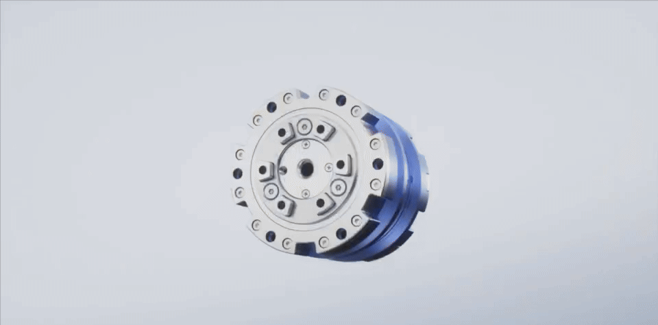
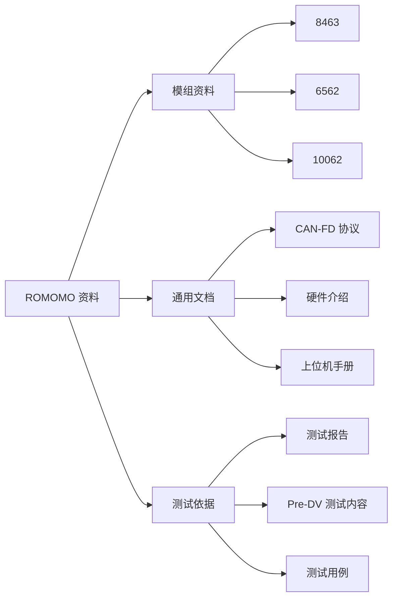

# ROMOMO 开源资料

[](LICENSE) [](https://github.com/Roboparty/ROMOMO)

RoboParty / ROMOMO 关节模组的公开文档、规格资料和测试报告。

[English README](README.md) · [浏览仓库文件](https://github.com/Roboparty/ROMOMO/tree/master)



## 关键参数

| 模组 | 额定电压 | 减速比 | 额定转速 | 峰值转速 | 额定转矩 | 峰值转矩 | 资料状态 |
|---|---:|---:|---:|---:|---:|---:|---|
| RMM10062-2E | 48 V | 22 | 80 RPM | 130 RPM | 44 N·m | 160 N·m | 测试报告 + 图纸 |
| RMM6562-2E | 48 V | 19.5 | 60 RPM | 200 RPM | 10 N·m | 35 N·m | 测试报告 + 图纸 |
| RMM8463-2E | 48 V | — | — | — | — | — | 图纸 |

> 参数来自仓库中的规格图纸和测试报告。`—` 表示对应公开规格中未列出该数据。

## 资料关系



## 目录结构

```text
8463/                         RMM8463 模组图纸
6562/                         RMM6562 测试报告和图纸
10062/                        RMM10062 测试报告和图纸
CANFD协议手册.pdf              CAN-FD 协议手册
RMM关节模组硬件介绍-V261013.pdf  关节模组硬件介绍
上位机使用手册.pdf              上位机使用手册
关节模组Pre-DV_测试内容_V1.0.pdf  Pre-DV 测试内容
萝博派对关节模组测试用例v1.0.pdf  关节模组测试用例
```

## 范围

本仓库只包含文档和测试资料，不包含软件、固件或源代码。代码根据对应代码仓库声明的 `GPL-3.0-only` 许可证单独授权。

## 许可证

本仓库中的文档、图片和测试资料拟采用 [CC BY 4.0](LICENSE)。转载或改编时，请保留署名、许可证链接，并标明修改。

CC BY 4.0 不授予商标、专利、隐私、肖像或第三方内容相关权利。RoboParty、Roboto Origin 及相关产品标识仍受适用的商标规则约束。

## 免责声明

资料按现状提供，仅供参考、开发和测试使用。测试报告和测试用例不构成安全保证、性能保证或适用于特定用途的保证。使用前请结合实际硬件、软件版本和运行环境独立验证。

